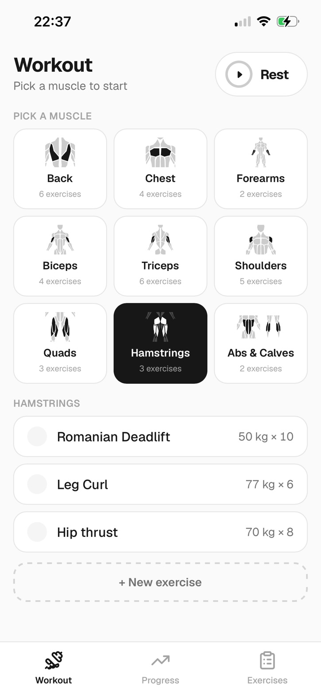
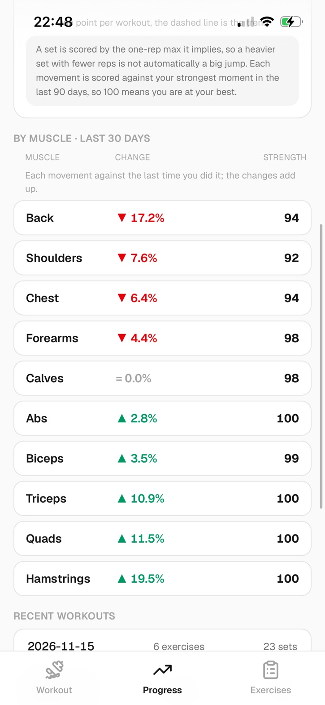
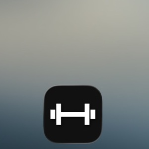

# OPOT

### Open Progressive Overload Tracker

**Log a set. See your next target. Back to lifting.**

[**Open the app →**](https://open-progressive-overload-tracker.vercel.app)

<table>
  <tr>
    <td></td>
    <td></td>
    <td></td>
  </tr>
</table>

---

## ⚡ Built for between sets

You're mid-workout. Sweaty, locked in, 90 seconds on the clock. You need **one answer**: *how much, how many reps?*

Most trackers make you dig for it: open a menu, pick a workout, open a page, open another page, scroll history. That's fine at a desk. It's useless between sets.

OPOT was built around that moment, and everything else bends to it.

| | Typical tracker | OPOT |
|---|---|---|
| Find your last weight & reps | Menus, pages, history | **Visible on the exercise list** |
| Know today's target | Do the math yourself | **Already calculated** |
| Log a set | Forms, keyboards, a save button | **Two steppers, done** |
| Lock the screen mid-rest | Hope nothing was lost | **Every set is already saved** |
| Bad gym signal | Spinner | **Works offline** |

**Two taps from the home screen to your target.** Muscle → exercise. That's it.

---

## What it does

### 🎯 Tells you what to do next
Open an exercise and you see **last time** and **today's target**. Log your weight and reps with the steppers.

- **Beat the target** → the next one goes up.
- **Miss it** → same weight waits until you hit the reps.

No remembering. No arithmetic with a plate in each hand.

### 💪 Organised by muscle
Nine muscle groups on the home screen, each with its own drawing. Tap one and see your exercises with **last weight × reps on every row**. Core movements are pre-loaded, and you can add your own anytime.

### 📈 Progress for the whole body and every muscle
Your sets become a **0–100 strength score** over 7 days, 30 days, or 3 months.

- Top chart: whole body
- Below it: every muscle, with the change since you last trained it
- 🟢 going up · 🔴 not

### 📴 No save button, no signal needed
Every set is written to your phone **the moment you log it**. Lock the screen, take a call, walk across the gym: it's still there. The app is cached, opens without signal, and syncs when you're back online.

### 🔒 Your data stays yours
Each account only sees its own workouts. Export everything as JSON anytime, or delete your account and your data goes with it.

---

## 📲 Put it on your home screen

No App Store. Open the link, add it to your home screen, and it runs full screen with its own icon.

| 1. Tap **Share** | 2. **Add to Home Screen** | 3. Done |
|---|---|---|
|  |  |  |

**iPhone:** use Safari. **Android:** use Chrome → *Install app* or *Add to Home screen*.

---

## 🧮 How the numbers work

1. Each set is converted to an **estimated one-rep max** (Epley formula), so a heavy 5 and a lighter 10 live on the same scale.
2. Each exercise is scored against **your own best set from the last 90 days**. 100 means you're at your best.
3. Every movement is measured against itself, so a shoulder press and a squat can share a chart.
4. Per-muscle change adds up the movements from your last workout: two exercises that each gained a rep count as twice the progress.

---

## Try it

[**Open OPOT →**](https://open-progressive-overload-tracker.vercel.app)

Just looking? Tap **Look around as a visitor** on the sign-in screen. It opens a demo account with a month of training. Nothing you do there is saved.

---

## Built with

Next.js · TypeScript · Tailwind CSS · Zustand · Redis

A personal project, built and used in a real gym.

## Licence

MIT. See [LICENSE](LICENSE).