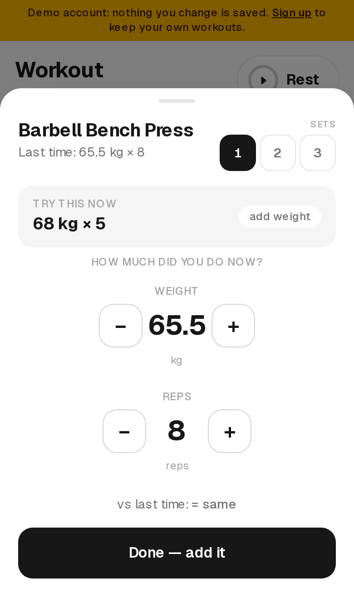
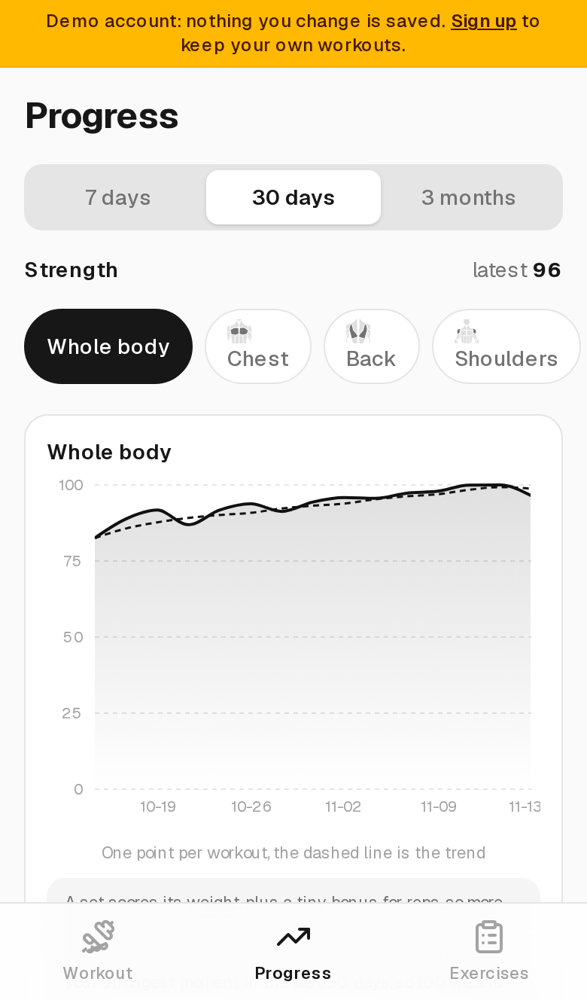
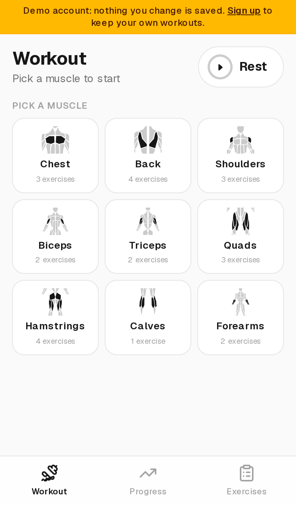
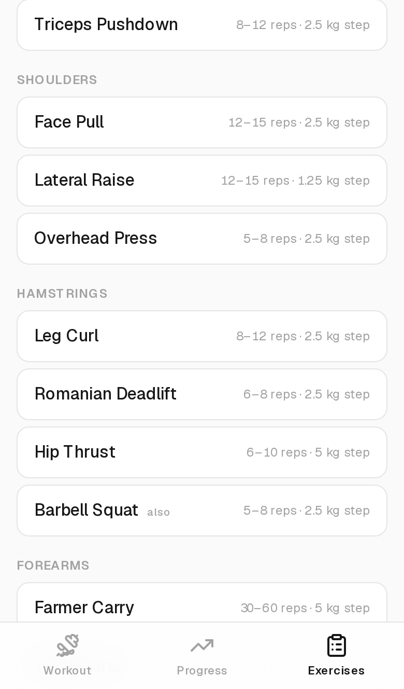
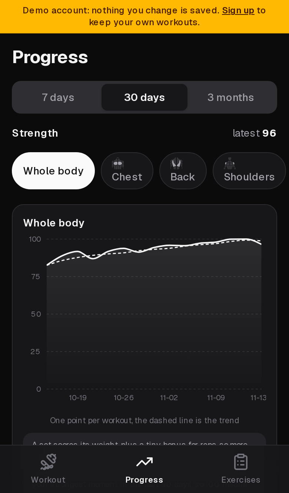

# Gym Progress

<p align="center">
  
  
  
</p>

<p align="center">
  <a href="https://github.com/Abdennourbd/gym-progress-app/actions/workflows/ci.yml"></a>
  <a href="LICENSE"></a>
  
  
</p>

A gym tracker built around one question:

> **Last time I did bench press 80 kg × 8. What should I do this time?**

Open the app between sets, tap the muscle you are training, tap the exercise,
and it tells you the target before you have picked up the bar. Every set you
log is compared against the last one, and every muscle you train gets its own
progress line, so you can see at a glance what is going up and what has
stalled.

It is a phone app that works in a gym with no signal, and every account keeps
its own workouts to itself.

---

## What it does

- **One set per exercise.** You log the set that matters, so comparing this
  session to last session is exact rather than approximate.
- **A target for next time.** Every exercise knows its rep range. Log 6 reps
  and it suggests 7. Reach the switch point and it says "add weight, drop back
  to 6".
- **Muscles, not a flat list.** Exercises live under the muscle they train,
  with a picture of that muscle, so finding the movement you want is two
  taps.
- **Progress per muscle and for the whole body.** A 0–100 strength score over
  7 days, 30 days or 3 months, plus a ranked list of every muscle with the
  change over the period.
- **Nothing to save.** There is no save button anywhere. Every edit is written
  to the device immediately and to the server a moment later. Close the phone
  between exercises and come back to exactly where you were.
- **Works with no signal.** The interface is cached and every edit is kept on
  the device first, so a set is never lost because the phone dropped off the
  network. Everything syncs when the signal comes back.
- **Your data is yours.** Export everything as JSON at any time, and delete the
  account and all of it whenever you want.

## Screens

| | |
| --- | --- |
| **Log a set** — the last time, the target for next time, and two steppers. | **Progress** — whole body and per muscle, over any window. |
|  |  |
| **The muscle grid** — tap the muscle you are training today. | **The library** — every exercise, with its rep range and weight step. |
|  |  |

Dark mode is built in, not bolted on:

<p align="center">
  
</p>

There is also a shared **demo account** with a month of training in it. Anyone
can open the app and look around without making an account; nothing they do
there is saved.

## How the numbers work

**Set score** — a set scores its weight, plus a small bonus for each rep.
Adding weight always moves the score up, even when the reps drop to make room
for it:

```
10 kg × 10  →  10.10
12 kg × 6   →  12.06   (heavier, so it still wins)
80 kg × 8   →  80.08
0 kg × 12   →  0.12    (bodyweight work, scored by reps)
```

A bodyweight set is scored by reps divided by 100, so it can never outscore
real kilograms.

**Strength (0–100)** — every exercise is scored against its own strongest set
in the last 90 days:

```
strength = 100 × score(today) ÷ best score in the last 90 days
```

Because each exercise is normalised against its own baseline, a shoulder press
and a squat can be compared honestly, and your heaviest lift does not drown
out your lightest one. 100 means you are at your best.

**Whole body** — the mean of the strength scores of the muscles you trained
that day. It answers "am I getting stronger overall" with a single number.

**Next target** — worked out from what you just lifted:

| You did | Rep range | Next time |
| --- | --- | --- |
| 6 reps | 6–12 | 7 reps, same weight |
| 9 reps | 6–12 | 10 reps, same weight |
| 10 reps | 6–12 | **+2.5 kg, back to 6 reps** |
| 11 reps | 6–12 | **+2.5 kg, back to 6 reps** |
| 12 reps | 6–12 | **+2.5 kg, back to 6 reps** |
| 4 reps | 6–12 | 6 reps, same weight |

The switch point is `max − 2` by default and can be changed per exercise.

## Running it locally

```bash
npm install
npm run dev
```

That is the whole setup. Without any cloud credentials the app keeps
everything in `.data/` on the server and in IndexedDB in the browser, so you
can make an account from the login screen and start logging straight away.

In development the session cookie is signed with a temporary secret, so
restarting the server signs everybody out. To keep people signed in, put one
in `.env.local`:

```env
AUTH_SECRET=<at least 32 random characters>
```

```bash
node -e "console.log(require('node:crypto').randomBytes(32).toString('base64url'))"
```

makes one. In production it is required: without it the app refuses to sign a
session rather than run with a secret everybody can guess.

Copy `.env.example` to `.env.local` if you want a starting point.

### The other commands

```bash
npm test           # unit tests
npm run test:e2e   # real browser tests (needs: npx playwright install chromium)
npm run lint
npm run typecheck
npm run build
```

### A demo account to look at

```bash
node scripts/seed-demo.mjs --local   # fills the local file store
```

This creates the shared `demo` account with a month of believable training in
it: the big lifts climb, a few accessories stall on purpose, so every chart
has something to say. The demo account is read-only on the server, so nothing
can spoil it.

### The scripts

| Script | What it does |
| --- | --- |
| `scripts/seed-demo.mjs` | Fills the demo account. `--local` for the file store, otherwise the cloud store. |
| `scripts/seed-account.mjs` | Makes an account and copies a saved dataset into it. |
| `scripts/import-log.mjs` | Turns a written log into exercises and one session. |
| `scripts/merge-sessions.mjs` | Merges the fragments of a day into one session and drops exact duplicates. |
| `scripts/screenshots.mjs` | Takes the pictures in this readme. |
| `scripts/make-icons.mjs` | Draws the app icons. No dependencies, it writes the PNGs itself. |
| `scripts/generate-muscle-icons.mjs` | Rebuilds the muscle drawings from the anatomy data. |

## Deploying

The app is a standard Next.js project, so Vercel works out of the box.

```bash
npx vercel login
npx vercel install upstash/upstash-kv   # creates the database
npx vercel env add AUTH_SECRET production
./deploy.sh
```

Or connect the repository in the Vercel dashboard and every push deploys on
its own. The Upstash integration fills in `KV_REST_API_URL` and
`KV_REST_API_TOKEN` for you.

The deployment has to be served over **https**: in production the session
cookie is marked secure and carries the `__Host-` prefix, so a browser will
not keep it over plain http.

### Configuration

| Variable | Purpose |
| --- | --- |
| `AUTH_SECRET` | Signs the session cookie. 32+ characters. Required in production. |
| `KV_REST_API_URL` | The store. Filled in by the Upstash integration. |
| `KV_REST_API_TOKEN` | The store. Filled in by the Upstash integration. |
| `GYM_INVITE_CODE` | Optional. When set, an account needs this code before it can be created. |

`UPSTASH_REDIS_REST_URL` and `UPSTASH_REDIS_REST_TOKEN` work as well, if you
would rather set up Upstash yourself.

Without a store the app falls back to a local file on the server, which is
only useful in development.

### Locking the signup

Leave `GYM_INVITE_CODE` unset and anyone with the link can make an account.
Set it and the sign up screen asks for the code first. The code is compared in
constant time, so it cannot be guessed a piece at a time.

## How it is put together

```
src/
  app/                  route handlers and the single page
  components/
    workout/            logging: the muscle grid, the entry sheet, the timer
    progress/           charts, the range picker, the ranked muscle list
    exercises/          the library, the editor, the settings
  lib/
    training/           pure maths: strength, suggestions, history, dates
    server/             accounts, sessions, storage
    client/             the local mirror, the store, the sync
scripts/                seeding, importing a log, screenshots, icons
e2e/                    Playwright tests
```

A few decisions worth knowing about:

- **The maths is pure.** Everything in `src/lib/training/` is a plain
  function with no React and no I/O, so it can be tested on its own and
  reasoned about without a browser. The unit tests cover it thoroughly.
- **The device is the source of truth for the interface.** The screen always
  reads from a local mirror in IndexedDB, so logging a set never waits on the
  network. The server is the durable copy, not the fast one.
- **Everything is namespaced per account.** Each account gets its own keys in
  the store and its own keys on the device, so two accounts can never be mixed
  up, not even on a shared phone.
- **The server merges, it does not overwrite.** If you add an exercise offline
  it survives even when the server already has more, and when two devices
  disagree about a workout the newer one wins.
- **Exercises are archived, never deleted.** A deleted record would come back
  the moment a device with an older copy of the list reconnects. An archived
  exercise keeps its history in every chart and can be restored.

`docs/architecture.md` goes into the details: the data model, the merge rules
and the sync loop.

## Security

The short version: passwords are hashed with scrypt, sessions are signed
tokens in an httpOnly cookie, every request is checked for a session and for
ownership of what it touches, and the write endpoints refuse the demo
account.

- **Passwords** are stored as scrypt hashes with a per password salt
  (N=16384, r=8, p=1, 64 byte key). The work is done off the main thread, so
  a burst of sign in attempts cannot stall the server for everyone else. A
  sign in for a name that does not exist is checked against a decoy hash, so
  it takes the same time as a sign in with a wrong password.
- **Sessions** are HS256 tokens in an httpOnly, sameSite cookie, marked
  secure and `__Host-` prefixed in production. They last ten days of
  inactivity and are slid forward on every authenticated request. The account
  is looked up on every request, so a session for an account that has been
  deleted stops working at once.
- **Rate limits** sit on sign in, sign up and account removal. They are kept
  in the same store as everything else when there is one, so the limit holds
  across every instance of a serverless deployment. Sign in attempts are
  counted per address and per account name, and only the wrong ones count.
- **Input** is checked at every boundary with a schema, and bodies over
  512 KB are refused before they are read.
- **Responses** carry a content security policy, HSTS, `nosniff`, a framing
  ban and a permissions policy. The api is never cached.
- **The service worker** caches the shell of the app and nothing else. The
  answers to "what is on this account" are never cached, because a cached
  answer belongs to whoever asked for it, and on a shared phone the next
  person would be handed the last person's training.
- **Your data** can be exported as JSON and the account can be deleted,
  which removes the exercises, the workouts and the settings from the server
  and from the device.

Please read [SECURITY.md](SECURITY.md) before reporting a problem.

## Contributing

Bug reports, ideas and pull requests are welcome. Have a look at
[CONTRIBUTING.md](CONTRIBUTING.md) first: it explains how to run the app, how
the tests are laid out and what a good change looks like here.

## Licence

MIT. See [LICENSE](LICENSE).
