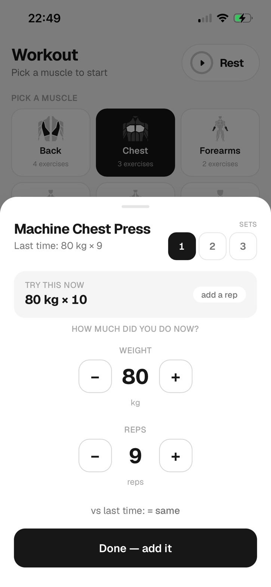
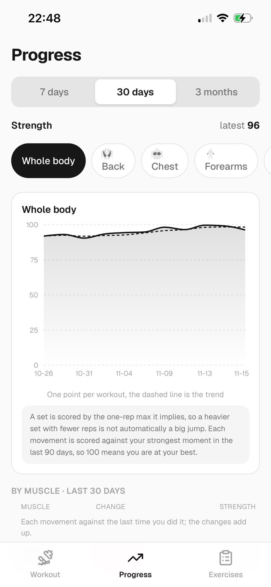
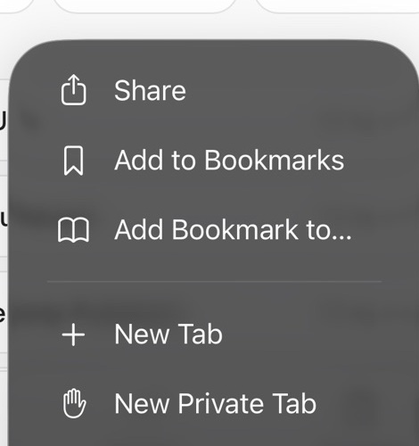

# OPOT

**Open Progressive Overload Tracker**

[**Open the app →**](https://open-progressive-overload-tracker.vercel.app)

  
  
  

> **Open it between sets. Tap the muscle. Tap the exercise. The target is already there.**

OPOT is a gym tracker built for the 30 seconds between sets — when you're sweating,
locked in, and don't want to fight an app. Most trackers make you dig through
menus, tabs, and forms to reach the weight and reps for your next set. OPOT gives
you the answer in two taps.

**No save button. No page hops. No friction.**

## Why it exists

Other apps are built around logging what you did. OPOT is built around the next
set: the weight, the reps, and whether the number is moving in the right
direction. The whole app exists to make that answer fast enough to use while you're
still breathing hard.

## Built for the gym, not the desk

- **Two taps to your target.** Muscle → exercise → the number.
- **Nothing to save.** Every set writes to your phone the instant you log it.
- **Works with no signal.** The interface is cached and syncs when the bars return.
- **Big steppers.** Made for a sweaty thumb between sets.
- **No account needed to look around.** Tap *Look around as a visitor* on the
  sign-in screen.

## What it does

- **A target before you touch the bar.** Last time's numbers and today's target,
  side by side. Beat it and the next one moves up; miss it and the same weight
  waits for you.
- **Nine muscle groups** with their own drawings. Tap the one you're training and
  you get the exercises you actually do, with your last weight and reps on every
  row. It starts with the core movements for each muscle, and you can add your
  own.
- **Progress in one number.** A 0–100 strength score for your whole body and every
  muscle, over 7 days, 30 days, or 3 months. Green means it's going up, red means
  it isn't.
- **Your training stays yours.** Per-account data, export everything as JSON, or
  delete the account and the data with it.

## Screens

  
  
  

## Put it on your home screen

OPOT is a web app. No App Store download, no install wizard: open the link on your
phone, add it to your home screen, and it opens full screen with its own icon.

| 1. Tap **Share** | 2. Tap **Add to Home Screen** | 3. It's on your home screen |
| :---: | :---: | :---: |
|  |  |  |

On iPhone, open the site in Safari and use the steps above. On Android, open it in
Chrome and choose **Install app** or **Add to Home screen** from the menu.

## How the numbers work

Each set is scored by the one-rep max it implies, estimated with the Epley
formula, so a heavy set of 5 and a lighter set of 10 sit on the same scale. Each
exercise is then scored against your own best set from the last 90 days, which is
where the 0–100 strength number comes from: 100 means you're at your best.

Because every movement is measured against itself, a shoulder press and a squat can
share a chart without one drowning out the other. The per-muscle change adds up
the movements from your last workout, so two exercises that each gained a rep
count as twice the progress.

## Try it

[**Open OPOT →**](https://open-progressive-overload-tracker.vercel.app)

If you only want to look around, choose **Look around as a visitor** on the
sign-in screen. It opens a demo account with a month of training in it. Nothing
you do there is saved.

## Built with

Next.js and TypeScript, as a personal project built and used in a real gym.

## Licence

MIT. See [LICENSE](LICENSE).
