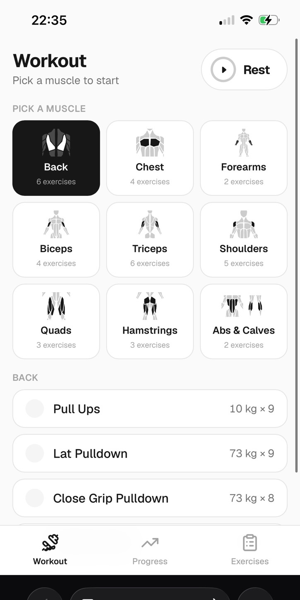
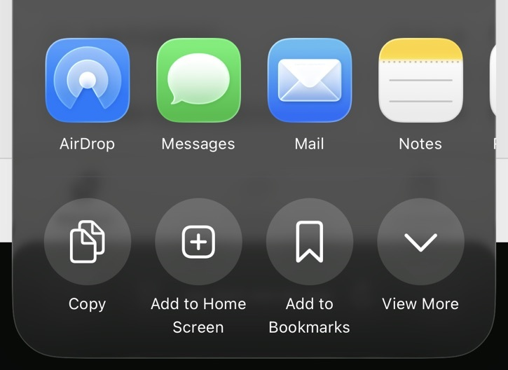

# OPOT

**Open Progressive Overload Tracker**

[**Open the app →**](https://open-progressive-overload-tracker.vercel.app)

  
  
  

You finish a set of bench press and look at the bar. One question decides the next set: *how much this time?*

OPOT answers it. It remembers what you lifted last session, gives you a target for today, and tracks whether every muscle is actually moving forward. No spreadsheet, no notebook, no guessing from memory.

It runs in your phone's browser and installs to your home screen, so it opens full screen, works without a signal, and keeps your training on your own account.

## Why it exists

Most trackers are good at recording what you did. OPOT is built around the next set: the weight, the reps, and whether the number is going in the right direction. Everything else in the app exists to make that answer fast enough to use between sets.

## What it does

### It tells you what to do next

Open an exercise and the sheet already knows what you did last time. It shows a target for today, then two steppers for the weight and reps you actually managed. Beat the target and the next one moves up. Miss it and the same weight waits for you until you hit the reps.

The point is that you never have to remember the last session or do the arithmetic with a plate in each hand.

### The gym, organised by muscle

The home screen is nine muscle groups, each with its own drawing. Tap the one you are training and you get the exercises you actually do for it, with your last weight and reps on every row. The starter library has 35 exercises, and you can add your own whenever you need one.

  

### Progress for the whole body and every muscle

The Progress tab turns your sets into a 0–100 strength score over 7 days, 30 days, or 3 months. The top chart is your whole body. The list underneath breaks it down by muscle and shows the change since the last time you trained it. Green means it is going up. Red means it is not.

  

### No save button, no signal needed

Every set is written to your phone the moment you log it. Lock the screen, take a call, walk to the other end of the gym: when you come back, the set is there. The app is cached, so it opens without a signal and syncs when the bars return.

### Your training stays yours

Each account only sees its own workouts. Export everything as JSON whenever you want, or delete the account and the data with it.

## Put it on your home screen

OPOT is a web app. There is no App Store download and no install wizard: open the link on your phone, add it to your home screen, and it opens full screen with its own icon.

| 1. Tap **Share** | 2. Tap **Add to Home Screen** | 3. It is on your home screen |
| :---: | :---: | :---: |
|  |  |  |

On iPhone, open the site in Safari and use the steps above. On Android, open it in Chrome and choose **Install app** or **Add to Home screen** from the menu.

## How the numbers work

Every set is converted to the one-rep max it implies, using the Epley formula. That lets a heavy set of 5 and a lighter set of 10 sit on the same scale. Each exercise is then scored against your own best set from the last 90 days, which is where the 0–100 strength number comes from: 100 means you are at your best.

Because every movement is measured against itself, a shoulder press and a squat can share a chart without one drowning out the other. The per-muscle change adds up the movements from your last workout, so two exercises that each gained a rep count as twice the progress.

## Try it

[**Open OPOT →**](https://open-progressive-overload-tracker.vercel.app)

If you only want to look around, choose **Look around as a visitor** on the sign-in screen. It opens a demo account with a month of training in it. Nothing you do there is saved.

## Built with

Next.js and TypeScript, as a personal project built and used in a real gym.

## Licence

MIT. See [LICENSE](LICENSE).
